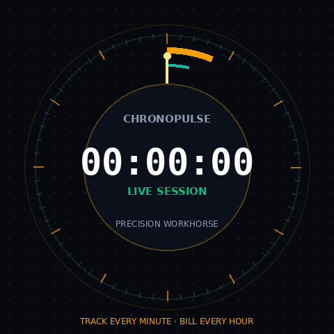
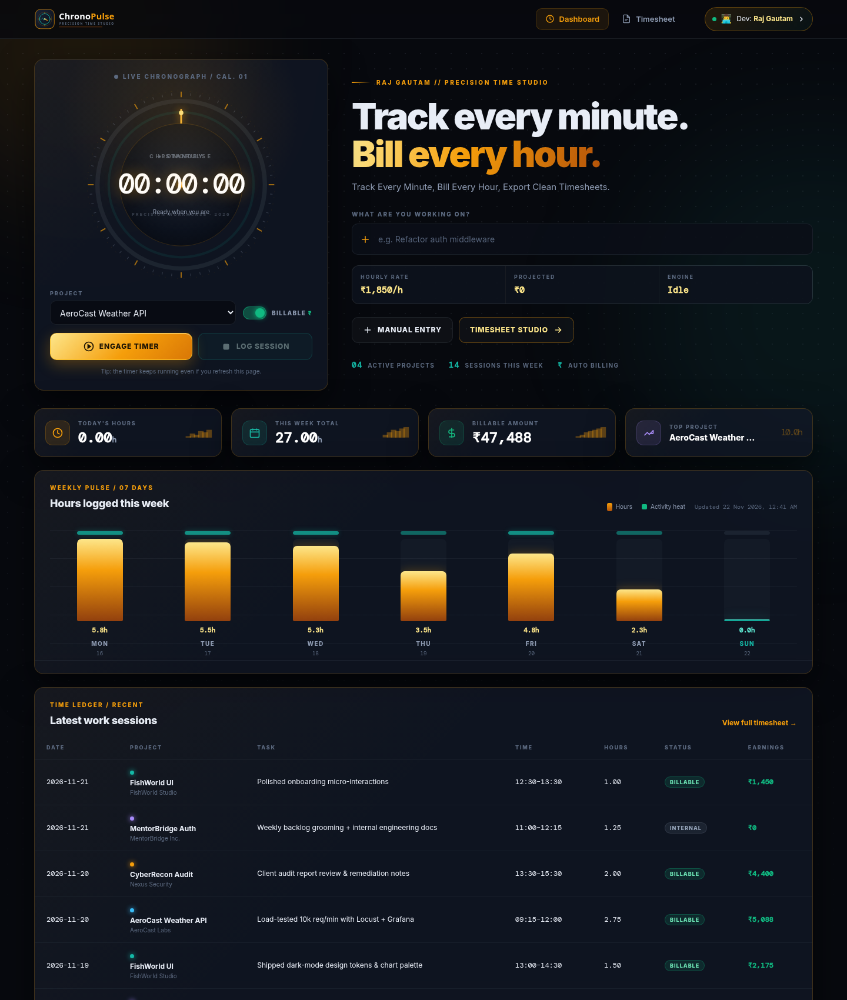
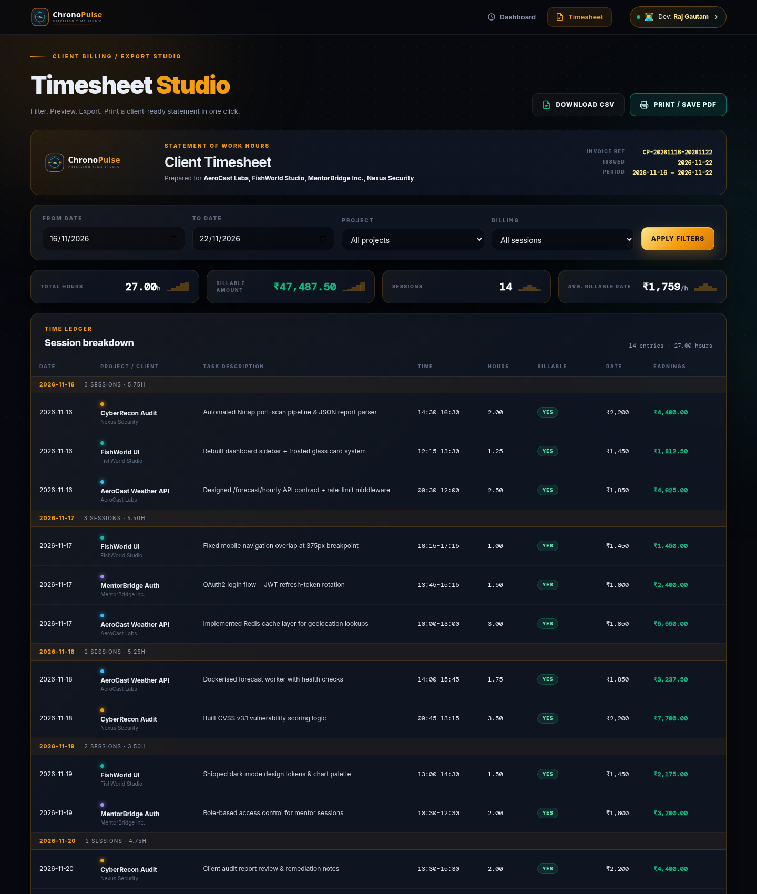
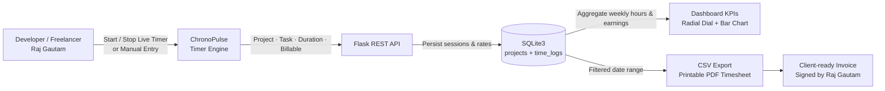

<div align="center">


<br/>


# ChronoPulse

### Precision Work-Hour Tracker & Automated Timesheet Studio

> **Track Every Minute, Bill Every Hour, Export Clean Timesheets.**

[](https://www.python.org/)
[](https://flask.palletsprojects.com/)
[](https://www.sqlite.org/)
[](LICENSE)
[](https://github.com/Rg100152)

**Developed by [Raj Gautam](https://github.com/Rg100152)** · 📧 graj13099@gmail.com · 📱 +91 9555785729 · 📸 [@linuxuser.raj](https://instagram.com/linuxuser.raj)

</div>

---

## 🎛️ Live Chronograph Preview

<div align="center">
  
  <br/><sub><b>Animated SVG-style chronograph dial — seconds ring, pulse needle & live HH:MM:SS</b></sub>
</div>

---

## 🖥️ Product Screenshots

### Dashboard — Live Chronograph + Weekly Pulse

<div align="center">
  
</div>

### Timesheet Studio — Filter, Preview, Export, Print

<div align="center">
  
</div>

---

## ⚡ What ChronoPulse Does

ChronoPulse replaces scattered spreadsheets with a **single precision instrument** for your workday:

- **Live Radial Chronograph** — an animated analog-digital dial with a seconds ring, minute ring, sweeping needle and a glowing `HH:MM:SS` readout.
- **Refresh-Proof Timer** — active sessions are persisted in `localStorage`; reloading the page never loses a running clock.
- **Project-Aware Billing** — pick a project, toggle billable, and earnings are computed automatically from the hourly rate (₹ or $).
- **KPI Command Deck** — Today's Hours, This Week Total, Billable Amount and Top Project, refreshed live after every log.
- **Weekly Pulse Chart** — a 7-day bar chart with GitHub-style activity heat blocks (Mon → Sun).
- **Timesheet Studio** — filter by date range, project and billing type; preview a clean invoice-style table; **download CSV** or **print / save as PDF**.
- **Developer Identity** — Raj Gautam's signature, badge, avatar and credits are woven into the navbar, footer modal, printed timesheet and this README.

---

## 🧠 System Design

### Architecture / Data Flow Diagram



### Database Schema

| Table | Columns |
| --- | --- |
| `projects` | `id`, `name`, `client_name`, `hourly_rate`, `color_tag`, `created_at` |
| `time_logs` | `id`, `project_id` (FK), `task_description`, `log_date`, `start_time`, `end_time`, `duration_seconds`, `billable`, `earnings`, `created_at` |

### Tech Stack

| Layer | Technology |
| --- | --- |
| Frontend | HTML5, CSS3 (obsidian + amber glass UI), Vanilla JavaScript |
| Backend | Python 3 + Flask 3 |
| Storage | SQLite3 (zero-configuration, single file) |
| Export | CSV with UTF-8 BOM (Excel-ready) + browser print-to-PDF |
| Dependencies | Flask only — runs comfortably on 4 GB Pop!_OS / Linux |

---

## 📁 Project Structure

```
ChronoPulse/
├── app.py                       # Flask server, REST APIs, reports & CSV export
├── seed_logs.py                 # 4 client projects + 14 realistic sessions
├── requirements.txt             # flask
├── README.md                    # This document
├── .gitignore
├── database/
│   └── chronopulse.db           # Generated on first run
├── templates/
│   ├── base.html                # Navbar, developer badge/modal, footer
│   ├── index.html               # Radial chronograph, KPIs, chart, ledger
│   └── timesheet.html           # Filterable timesheet + print layout
├── static/
│   ├── css/chronopulse.css      # Swiss dark UI + @media print rules
│   ├── js/chronograph.js        # Timer engine, localStorage, chart, modals
│   └── assets/
│       ├── logo-chronopulse.svg # Custom vector logo
│       ├── banner.jpg
│       ├── avatar.jpg
│       ├── chronopulse-demo.gif # Animated README demo
│       ├── screenshot-dashboard.png
│       └── screenshot-timesheet.png
└── tools/generate_demo.py       # Regenerates the animated GIF (Pillow)
```

---

## 🚀 Quick Start

```bash
# 1. Setup
python3 -m venv venv
source venv/bin/activate
pip install -r requirements.txt

# 2. Seed demo data (4 projects, 14 sessions across the current week)
python3 seed_logs.py

# 3. Launch
python3 app.py
```

Open **http://127.0.0.1:5000** in your browser.

> Need a fresh demo dataset? Run `python3 seed_logs.py --reset`.

### Generate the README animation again

```bash
pip install pillow
python3 tools/generate_demo.py
```

---

## 🔌 API Endpoints

| Method | Endpoint | Purpose |
| --- | --- | --- |
| `GET` | `/` | Dashboard (server-rendered) |
| `GET` | `/timesheet` | Filterable timesheet preview |
| `GET` | `/timesheet/print` | Clean, auto-printing invoice layout |
| `GET` | `/api/dashboard` | KPIs, weekly chart, recent logs (JSON) |
| `GET` | `/api/projects` | List projects |
| `POST` | `/api/projects` | Add a project with an hourly rate |
| `POST` | `/api/log` | Save a live stopwatch or manual session |
| `DELETE` | `/api/log/<id>` | Remove a session |
| `GET` | `/api/export/csv` | Download filtered CSV timesheet |
| `GET` | `/health` | Health + record counts |

---

## 🧪 Smoke Test

```bash
curl http://127.0.0.1:5000/health
curl -X POST http://127.0.0.1:5000/api/log \
  -H 'Content-Type: application/json' \
  -d '{"project_id":1,"task_description":"API check","duration_seconds":900,"billable":true}'
curl "http://127.0.0.1:5000/api/export/csv?from=2026-11-16&to=2026-11-22" -o timesheet.csv
```

---

## 👨‍💻 Developer Credits

<div align="center">

| |
| :---: |
|  |
| **Raj Gautam** — Lead Developer & Full-Stack Engineer |
| 📧 [graj13099@gmail.com](mailto:graj13099@gmail.com) |
| 📱 [+91 9555785729](tel:9555785729) |
| 📸 [@linuxuser.raj](https://instagram.com/linuxuser.raj) |
| 🐙 [github.com/Rg100152](https://github.com/Rg100152) |
| *Verified & Engineered by Raj Gautam* |

</div>

---

## 📄 License

Released under the [MIT License](LICENSE). Built with precision on Pop!_OS by Raj Gautam.

<div align="center"><sub>ChronoPulse · Track Every Minute, Bill Every Hour, Export Clean Timesheets.</sub></div>
